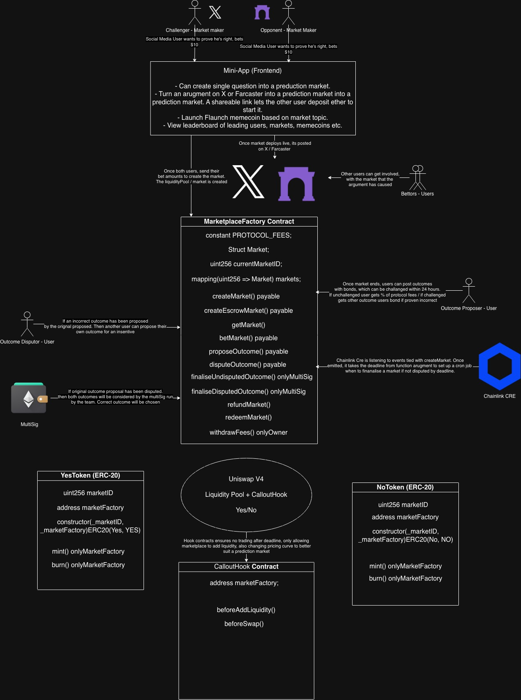

# 0xCallout

## Introduction

0xCallout is a prediction market you can spin up straight from a social media reply. Anyone can call out a claim, open a YES/NO market on it, and let people bet with ETH.

Under the hood, each market is a Uniswap v4 pool with a custom hook that replaces the standard x·y=k curve with LMSR (Logarithmic Market Scoring Rule) pricing. YES and NO prices always add up to 1, so the pool's price reads directly as the crowd's probability that the claim is true.

Built for the Atrium Hookathon (UHI11).

## Links

Live Demo:

Submission Video:

Presentation Slides:

**Hook Contract:**

- [CalloutHook.sol](./contracts/src/Hook/CalloutHook.sol)
- [LMSRLibrary.sol](./contracts/src/Hook/LMSRLibrary.sol)
- [Hook Tests](./contracts/test/Hook/)

**MarketplaceFactory Contract:**

- [IMarketplaceFactory.sol](./contracts/src/Marketplace/IMarketplaceFactory.sol)
- [MarketplaceFactory.sol](./contracts/src/Marketplace/MarketplaceFactory.sol)
- [PoolManagerLogic.sol](./contracts/src/Marketplace/PoolManagerLogic.sol)
- [Errors.sol](./contracts/src/Marketplace/Errors.sol)
- [Marketplace Tests](./contracts/test/Marketplace/)

**ERC20 Contracts:**

- [YesToken.sol](./contracts/src/erc20s/yesToken.sol/)
- [NoToken.sol](./contracts/src/erc20s/noToken.sol/)

## Problems being solved

## How it works

## Architecture Diagram

## Tests

## Future Roadmap
